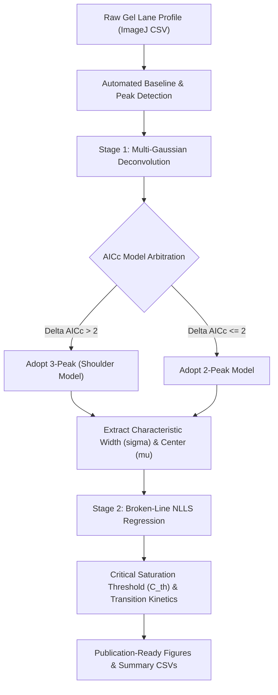

# 🧬 GelPhase: Automated Biomolecular Gel Deconvolution & Phase-Transition Threshold Analyzer

[](LICENSE)
[](https://www.python.org/)
[]()

> **GelPhase** is a high-throughput, reproducible computational pipeline designed for biomolecular research (DNA/RNA nanotechnology, synthetic biology, protein biochemistry). It deconvolves gel electrophoresis lane intensity profiles (from ImageJ) using **Gaussian multi-peak modeling**, statistically arbitrates models via **Akaike Information Criterion (AICc)**, and accurately determines **saturation/breakdown phase-transition thresholds** through **Nonlinear Piecewise (Broken-Line) Regression**.

---

## 🔬 Background & Motivation

In biomolecular design (such as **BIOMOD** and **iGEM** projects), assessing the structural stability of nanodevices in biological fluids (e.g., Fetal Bovine Serum / FBS assays) is critical. Traditional workflow involves:
1. Exporting lane profiles manually via ImageJ.
2. Subjectively fitting baselines and peak widths in OriginLab or GraphPad Prism.
3. Guessing whether a peak is a doublet, shoulder, or broad single peak.

**Pain points**: Manual curve fitting is slow, prone to human cognitive confirmation bias, and difficult to reproduce across labs.

**GelPhase Solution**: A fully automated, objective, mathematically verified pipeline that transforms raw lane CSVs into publication-grade saturation thresholds and multi-panel figures in seconds.

---

## 📐 Computational & Mathematical Pipeline



### 1. Gaussian Deconvolution
Each molecular state band is modeled as a Gaussian profile on a linear background:
$$y(x) = (\beta_0 + \beta_1 x) + \sum_{i=1}^{M} A_i \exp\left(-\frac{(x - \mu_i)^2}{2\sigma_i^2}\right)$$
* $\mu_i$: Band migration center (pixels / distance).
* $\sigma_i$: Band width metric (structural integrity / dispersion indicator).

### 2. Objective Model Selection (AICc)
To avoid overfitting without human bias:
$$\text{AICc} = n \ln\left(\frac{\text{RSS}}{n}\right) + 2k + \frac{2k(k + 1)}{n - k - 1}$$
A shoulder peak is retained if and only if $\Delta\text{AICc} > 2.0$.

### 3. Continuous Piecewise Linear (Broken-Line) Regression
Phase-transition saturation breakpoint determination:
$$\sigma(C) = y_0 + s_1 C + \Delta s \max(0, C - C_{\text{th}})$$
* $C_{\text{th}}$: **Critical Saturation Threshold (Breakpoint)**.
* $s_1$: Pre-transition slope (low concentration).
* $s_2 = s_1 + \Delta s$: Post-transition kinetic slope (structural breakdown / broadening).

---

## 🚀 Quick Start Guide

### 1. Installation
Clone the repository and install the standard scientific Python packages:
```bash
git clone https://github.com/your-username/GelPhase.git
cd GelPhase
pip install -r requirements.txt
```

### 2. Data Organization
Organize your ImageJ line-profile CSV files inside the data directory:
```text
data/
  ├── 2hr/
  │     ├── C2/
  │     │     ├── sample_0%.csv
  │     │     ├── sample_1%.csv
  │     │     ├── sample_5%.csv
  │     │     └── sample_10%.csv
  │     └── ...
  └── 4hr/ ...
```
*(Each CSV should simply contain 2 columns: column 0 = pixel distance $x$, column 1 = gray value intensity $y$)*.

### 3. Execution Options

#### Option A: Interactive Streamlit Web App (Recommended for Cloud & Local)
* **Local Run**:
  ```bash
  streamlit run app.py
  ```
  *(Or double-click `run_windows.bat` on Windows)*.
* **Deploy to Streamlit Community Cloud**:
  1. Push this repository to GitHub.
  2. Go to [share.streamlit.io](https://share.streamlit.io) and click **New app**.
  3. Select your repository and branch (`main`).
  4. Set **Main file path** to: `app.py` (or `GelPhase/app.py` if nested).
  5. Click **Deploy!**

#### Option B: Headless Command Line (CLI Batch Processing)
```bash
python run_analysis.py --data path/to/data --output results
```

---

## 📊 Benchmark Validation (BIOMOD Serum Stability Assay)

Tested on 24 independent experimental gel profiles across two incubation durations (2hr vs 4hr) and replicates (C2, E2-1, E2-2):

| Incubation | Sample Group | Saturation Threshold ($C_{\text{th}}$) | Low-Conc Slope ($s_1$) | High-Conc Slope ($s_2$) | State Transition |
| :---: | :---: | :---: | :---: | :---: | :---: |
| **2hr** | **C2** | **5.00%** | 0.229 | **6.541** | Sharp Breakdown |
| **2hr** | **E2-1** | **5.00%** | 0.035 | **7.114** | Sharp Breakdown |
| **2hr** | **E2-2** | **7.68%** | 0.151 | **3.811** | Delayed Transition |
| **4hr** | **C2** | **4.53%** | 0.072 | **13.316** | Severe Breakdown |
| **4hr** | **E2-1** | **5.33%** | 0.230 | **5.064** | Sharp Breakdown |

> **Key Biological Finding**: Multiple independent biological conditions converged precisely on a **$\sim 5\%$ FBS Critical Breakdown Threshold**, validating the robustness and orthogonal reproducibility of the analytical pipeline.

---

## 📝 How to Cite in BIOMOD / Scientific Publications

If you use **GelPhase** in your competition project, Wiki, or research paper, please cite:

```bibtex
@software{gelphase2026,
  author = {BIOMOD Research Team and GelPhase Contributors},
  title = {GelPhase: Automated Gel Lane Profile Deconvolution and Saturation Threshold Analyzer},
  year = {2026},
  url = {https://github.com/your-username/GelPhase},
  version = {1.0.0}
}
```

### Wiki Attribution Statement Example:
> *"Gel lane profile deconvolution, AICc model arbitration, and saturation threshold broken-line regressions were performed using the open-source pipeline **GelPhase** (developed with AI assistance from Google DeepMind Antigravity and verified by team members). Code is publicly available under the MIT License."*

---

## 🤝 Contributing & Community Customization

GelPhase is fully open-source under the **MIT License**. We actively encourage future BIOMOD and iGEM teams to fork, customize, and extend this repository:
* Add custom non-linear models (e.g., Hill equations, Sigmoidal kinetics).
* Integrate direct multi-lane TIFF / Gel image batch segmentation.
* Add GUI interfaces (Streamlit / PyQt).

Pull requests and issues are warmly welcomed!
